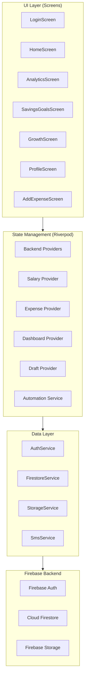
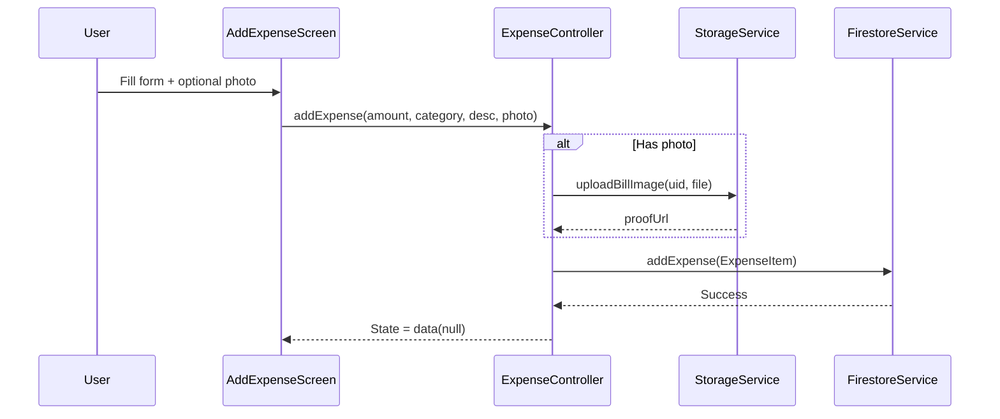
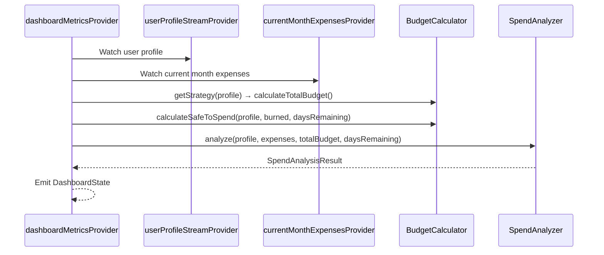

# BrickByBrick — Project Documentation

> *"Architecture of Financial Freedom"* — A premium Flutter personal finance tracker with smart budgeting, SMS-based expense detection, gamification, and analytics.

---

## 1. Project Overview

**BrickByBrick** is a mobile personal finance application built with Flutter. It helps users track expenses, manage budgets, set savings goals, and gamify their financial discipline. The app targets the Indian market with ₹ (INR) as the default currency and supports parsing Indian bank SMS formats.

### Key Features

| Feature | Description |
|---|---|
| **Smart Expense Tracking** | Manual expense entry with categories, descriptions, and receipt photo uploads |
| **SMS Auto-Detection** | Automatically parses bank transaction SMS messages to create draft expenses |
| **Salary-Based Budgeting** | Configurable budget rules with percentage or fixed-amount allocations per category |
| **Survival Score** | Real-time spend analysis with "days to bankruptcy" prediction |
| **Savings Goals (Brick Vault)** | Create, track, and top-up savings goals with progress visualization |
| **Gamification** | XP system, daily login streaks, leveling, and achievement badges |
| **Analytics** | Pie charts (by category), bar charts (daily intensity), and heatmaps |
| **Monthly Rollover** | Automated carry-forward of unspent budget to the next salary cycle |

---

## 2. Tech Stack

| Layer | Technology |
|---|---|
| **Framework** | Flutter (Dart SDK `^3.10.3`) |
| **State Management** | [Riverpod](https://riverpod.dev/) (`flutter_riverpod: ^2.5.1`) |
| **Backend / Auth** | Firebase Auth (`^5.4.1`), Google Sign-In (`^6.2.1`) |
| **Database** | Cloud Firestore (`^5.5.0`) |
| **File Storage** | Firebase Storage (`^12.0.0`) |
| **Charts** | [fl_chart](https://pub.dev/packages/fl_chart) (`^1.1.1`) |
| **Typography** | [Google Fonts](https://pub.dev/packages/google_fonts) — `Outfit` font family |
| **Navigation Bar** | [google_nav_bar](https://pub.dev/packages/google_nav_bar) (`^5.0.6`) |
| **SMS Parsing** | [flutter_sms_inbox](https://pub.dev/packages/flutter_sms_inbox) (`^1.0.3`) |
| **Permissions** | [permission_handler](https://pub.dev/packages/permission_handler) (`^11.1.0`) |
| **Other** | `intl`, `uuid`, `percent_indicator`, `font_awesome_flutter`, `image_picker`, `shared_preferences` |

### Platform Support

Currently configured for **Android only** (Firebase options are set for Android). iOS, Web, macOS, Windows, and Linux throw `UnsupportedError` in [firebase_options.dart](file:///c:/Development/project/brickbybrick/lib/firebase_options.dart).

---

## 3. Directory Structure

```
lib/
├── main.dart                          # App entry point, Firebase init, MaterialApp
├── firebase_options.dart              # FlutterFire CLI generated config
│
├── models/                            # Data classes
│   ├── user_model.dart                # UserProfile, BudgetRule
│   ├── expense_model.dart             # ExpenseItem
│   ├── savings_goal_model.dart        # SavingsGoal
│   ├── draft_expense.dart             # DraftExpense (parsed from SMS)
│   └── user_stats_model.dart          # UserStats (XP, streaks, achievements)
│
├── services/                          # Business logic, providers, API layer
│   ├── auth_service.dart              # Firebase Auth + Google Sign-In
│   ├── firestore_service.dart         # CRUD operations on Firestore
│   ├── storage_service.dart           # Firebase Storage (receipt uploads)
│   ├── sms_service.dart               # SMS parsing & transaction detection
│   ├── automation_service.dart        # Monthly rollover + gamification engine
│   ├── backend_providers.dart         # Core Riverpod providers (auth, firestore, storage)
│   ├── expense_provider.dart          # ExpenseController (add/delete expenses)
│   ├── salary_provider.dart           # SalaryController + userProfileStreamProvider
│   ├── dashboard_provider.dart        # DashboardState computation (metrics, analysis)
│   └── draft_provider.dart            # DraftNotifier (SMS draft management)
│
├── providers/
│   └── bottom_nav_providers.dart      # Bottom nav index state
│
├── screens/                           # UI screens
│   ├── approot.dart                   # Auth gate: LoginScreen ↔ MainScreen
│   ├── loginscreen.dart               # Email + Google sign-in
│   ├── main_screen.dart               # Bottom nav shell (5 tabs)
│   ├── homescreen.dart                # Dashboard with hero card, stats, survival score
│   ├── analytics_screen.dart          # Charts: pie, bar, heatmap
│   ├── savings_goals_screen.dart      # Brick Vault: goals list + create/top-up
│   ├── growth_screen.dart             # Gamification: streaks, XP, achievements
│   ├── profile_screen.dart            # User profile, salary, budget rules config
│   ├── add_expense_screen.dart        # TabView: Manual + Detected (SMS) tabs
│   ├── expense_detail_screen.dart     # Full expense receipt view + delete
│   ├── expense_history_screen.dart    # Scrollable list of all expenses
│   └── tabs/
│       ├── manual_expense_tab.dart    # Manual expense form
│       └── detected_expense_tab.dart  # SMS-detected draft expenses
│
└── utilities/                         # Helpers and utilities
    ├── app_theme.dart                 # AppTheme: colors, gradients, decorations, ThemeData
    ├── budget_calculator.dart         # BudgetStrategy pattern (Salary vs Budget-only)
    ├── spend_analyzer.dart            # SpendAnalyzer: survival score, predictions
    ├── smart_categorizer.dart         # Merchant → category mapping heuristic
    ├── expense_utils.dart             # Category → icon/color mapping
    ├── gap_func.dart                  # vertGap() / horiGap() helpers
    └── colors.dart                    # Color constant(s)
```

---

## 4. Architecture

### 4.1 High-Level Architecture



### 4.2 State Management Pattern

The app uses **Riverpod** with a mix of provider types:

| Provider Type | Usage |
|---|---|
| `Provider` | Singleton services ([AuthService](file:///c:/Development/project/brickbybrick/lib/services/auth_service.dart#4-46), [FirestoreService](file:///c:/Development/project/brickbybrick/lib/services/firestore_service.dart#7-98), [StorageService](file:///c:/Development/project/brickbybrick/lib/services/storage_service.dart#6-55)) |
| `StreamProvider` | Real-time Firestore streams (`userProfileStreamProvider`, `currentMonthExpensesProvider`, `savingsGoalsProvider`, `userStatsStreamProvider`) |
| `StateNotifierProvider` | Mutable controllers ([ExpenseController](file:///c:/Development/project/brickbybrick/lib/services/expense_provider.dart#13-96), [SalaryController](file:///c:/Development/project/brickbybrick/lib/services/salary_provider.dart#16-88), [DraftNotifier](file:///c:/Development/project/brickbybrick/lib/services/draft_provider.dart#9-30)) |
| `Provider.autoDispose` | Computed dashboard metrics (`dashboardMetricsProvider`) |
| `StateProvider` | Simple UI state (`bottomNavIndexProvider`) |

### 4.3 Navigation

- **Auth-gated navigation**: [AppRoot](file:///c:/Development/project/brickbybrick/lib/screens/approot.dart) watches `authStateChangesProvider` and renders [LoginScreen](file:///c:/Development/project/brickbybrick/lib/screens/loginscreen.dart#7-13) or [MainScreen](file:///c:/Development/project/brickbybrick/lib/screens/main_screen.dart#15-21)
- **Bottom navigation**: [MainScreen](file:///c:/Development/project/brickbybrick/lib/screens/main_screen.dart#15-21) uses `IndexedStack` with 5 tabs (Home, Stats, Vault, Grow, Self)
- **Named routes**: `/profile`, `/savings-goals`, `/growth`
- **Push navigation**: Expense add/detail/history screens use `Navigator.push`

---

## 5. Data Models

### 5.1 UserProfile + BudgetRule

**File**: [user_model.dart](file:///c:/Development/project/brickbybrick/lib/models/user_model.dart)

```dart
class BudgetRule {
  String id, category, priority;     // priority: 'hard' | 'soft'
  bool isPercentage;                  // true → percentage mode, false → fixed
  double percentage;                  // 0–1 range
  double fixedAmount;
}

class UserProfile {
  String uid, email;
  String? name, profession;
  double monthlySalary;
  int salaryDate;                     // Day of month (1-31)
  String incomeType;                  // 'Fixed salary' | 'Variable income'
  String budgetMode;                  // 'Salary-based' | 'Budget-only'
  List<BudgetRule> budgetRules;
  DateTime? lastRolloverDate;
  double carriedOverAmount;
}
```

### 5.2 ExpenseItem

**File**: [expense_model.dart](file:///c:/Development/project/brickbybrick/lib/models/expense_model.dart)

| Field | Type | Description |
|---|---|---|
| [id](file:///c:/Development/project/brickbybrick/lib/screens/expense_detail_screen.dart#246-249) | `String` | UUID |
| `userId` | `String` | Firebase Auth UID |
| `amount` | `double` | Expense amount in ₹ |
| `category` | `String` | Food, Travel, Rent, Shopping, etc. |
| [date](file:///c:/Development/project/brickbybrick/lib/screens/profile_screen.dart#662-668) | `DateTime` | Stored as ISO 8601 string |
| `description` | `String?` | Optional memo |
| `proofUrl` | `String?` | Firebase Storage download URL |

### 5.3 SavingsGoal

**File**: [savings_goal_model.dart](file:///c:/Development/project/brickbybrick/lib/models/savings_goal_model.dart)

| Field | Type | Description |
|---|---|---|
| [id](file:///c:/Development/project/brickbybrick/lib/screens/expense_detail_screen.dart#246-249) | `String` | UUID |
| `userId` | `String` | Firebase Auth UID |
| `name` | `String` | Goal name (e.g., "New iPhone") |
| `targetAmount` | `double` | Target savings amount |
| `currentAmount` | `double` | Currently saved (default 0) |
| `deadline` | `DateTime?` | Optional deadline |
| `icon` | `String` | Icon name string |
| **Computed** `progress` | `double` | `currentAmount / targetAmount` |
| **Computed** `isCompleted` | `bool` | `currentAmount >= targetAmount` |

### 5.4 DraftExpense

**File**: [draft_expense.dart](file:///c:/Development/project/brickbybrick/lib/models/draft_expense.dart)

Lightweight model for SMS-parsed transactions (not persisted to Firestore until user confirms):

| Field | Type | Description |
|---|---|---|
| [id](file:///c:/Development/project/brickbybrick/lib/screens/expense_detail_screen.dart#246-249) | `String` | UUID |
| `amount` | `double` | Parsed transaction amount |
| `merchant` | `String` | Extracted merchant name |
| [date](file:///c:/Development/project/brickbybrick/lib/screens/profile_screen.dart#662-668) | `DateTime` | SMS timestamp |
| `originalMessage` | `String?` | Raw SMS body |
| `bankName` | `String?` | Detected bank name |

### 5.5 UserStats

**File**: [user_stats_model.dart](file:///c:/Development/project/brickbybrick/lib/models/user_stats_model.dart)

| Field | Type | Description |
|---|---|---|
| `userId` | `String` | Firebase Auth UID |
| `streakCount` | `int` | Consecutive daily login count |
| `totalXP` | `int` | Accumulated experience points |
| `lastLoginDate` | `DateTime?` | Last login for streak calculation |
| `achievements` | `List<String>` | Unlocked achievement IDs |
| **Computed** `level` | `int` | [(totalXP / 100) + 1](file:///c:/Development/project/brickbybrick/lib/main.dart#12-17) |
| **Computed** `levelProgress` | `double` | [(totalXP % 100) / 100](file:///c:/Development/project/brickbybrick/lib/main.dart#12-17) |

---

## 6. Services

### 6.1 AuthService

[auth_service.dart](file:///c:/Development/project/brickbybrick/lib/services/auth_service.dart)

- [signInWithGoogle()](file:///c:/Development/project/brickbybrick/lib/services/auth_service.dart#15-31) — Google OAuth flow via `GoogleSignIn`
- [signInWithEmailAndPassword()](file:///c:/Development/project/brickbybrick/lib/services/auth_service.dart#33-39) — Firebase email/password auth
- [signOut()](file:///c:/Development/project/brickbybrick/lib/services/auth_service.dart#41-45) — Signs out from both Google and Firebase
- `authStateChanges` — Stream of auth state changes

### 6.2 FirestoreService

[firestore_service.dart](file:///c:/Development/project/brickbybrick/lib/services/firestore_service.dart)

| Method | Description |
|---|---|
| [saveUserProfile()](file:///c:/Development/project/brickbybrick/lib/services/firestore_service.dart#12-15) | Upsert user profile (merge) |
| [getUserProfileStream()](file:///c:/Development/project/brickbybrick/lib/services/firestore_service.dart#16-24) | Real-time user profile stream |
| [addExpense()](file:///c:/Development/project/brickbybrick/lib/services/expense_provider.dart#18-82) | Create expense document |
| [getExpensesStream()](file:///c:/Development/project/brickbybrick/lib/services/firestore_service.dart#31-42) | All expenses, ordered by date desc |
| [getExpensesByMonth()](file:///c:/Development/project/brickbybrick/lib/services/firestore_service.dart#43-65) | Expenses filtered by year/month range |
| [deleteExpense()](file:///c:/Development/project/brickbybrick/lib/services/firestore_service.dart#66-69) | Delete expense by ID |
| [getSavingsGoals()](file:///c:/Development/project/brickbybrick/lib/services/firestore_service.dart#70-80) | Stream of savings goals |
| [saveSavingsGoal()](file:///c:/Development/project/brickbybrick/lib/services/firestore_service.dart#81-84) | Upsert savings goal |
| [getUserStatsStream()](file:///c:/Development/project/brickbybrick/lib/services/firestore_service.dart#85-93) | Real-time user stats stream |
| [saveUserStats()](file:///c:/Development/project/brickbybrick/lib/services/firestore_service.dart#94-97) | Upsert user stats |

### 6.3 StorageService

[storage_service.dart](file:///c:/Development/project/brickbybrick/lib/services/storage_service.dart)

- [uploadBillImage(uid, file)](file:///c:/Development/project/brickbybrick/lib/services/storage_service.dart#9-54) — Uploads receipt image to `users/{uid}/receipts/` path
- Returns download URL on success
- Includes progress monitoring and detailed error logging

### 6.4 SmsService

[sms_service.dart](file:///c:/Development/project/brickbybrick/lib/services/sms_service.dart)

Parses device SMS inbox for financial transactions:

1. **Permission**: Requests SMS read permission
2. **Filtering**: Checks for keywords: `debited`, `spent`, `sent`, `paid`, `upi`
3. **Amount Parsing**: Regex matches `Rs.`, `INR`, `₹` followed by amount
4. **Merchant Detection**: Extracts merchant after [at](file:///c:/Development/project/brickbybrick/lib/screens/homescreen.dart#26-32)/[to](file:///c:/Development/project/brickbybrick/lib/models/user_model.dart#42-50)/`vpa` keywords, with fallbacks for known merchants (Zomato, Swiggy, Uber)
5. **Bank Detection**: Maps SMS sender IDs and body keywords to 35+ Indian banks

### 6.5 AutomationService

[automation_service.dart](file:///c:/Development/project/brickbybrick/lib/services/automation_service.dart)

Runs on app launch ([checkAndRunRollover()](file:///c:/Development/project/brickbybrick/lib/services/automation_service.dart#19-53)):

1. **Streak tracking**: Compares today vs `lastLoginDate`
   - Same day → no change
   - Next day → increment streak, award 10 XP
   - Gap > 1 day → reset streak to 1
2. **Monthly rollover**: Detects salary cycle boundaries and updates `lastRolloverDate`
3. **XP awarding**: [awardXP(amount)](file:///c:/Development/project/brickbybrick/lib/services/automation_service.dart#94-103) for ad-hoc XP grants

---

## 7. Providers (Riverpod)

### Core Providers — [backend_providers.dart](file:///c:/Development/project/brickbybrick/lib/services/backend_providers.dart)

```
authServiceProvider          → Provider<AuthService>
firestoreServiceProvider     → Provider<FirestoreService>
storageServiceProvider       → Provider<StorageService>
authStateChangesProvider     → StreamProvider<User?>
currentUserIdProvider        → Provider<String?>
```

### User & Salary — [salary_provider.dart](file:///c:/Development/project/brickbybrick/lib/services/salary_provider.dart)

```
userProfileStreamProvider    → StreamProvider<UserProfile?>
salaryControllerProvider     → StateNotifierProvider<SalaryController>
```

### Expenses — [expense_provider.dart](file:///c:/Development/project/brickbybrick/lib/services/expense_provider.dart)

```
expenseControllerProvider    → StateNotifierProvider<ExpenseController>
```

### Dashboard — [dashboard_provider.dart](file:///c:/Development/project/brickbybrick/lib/services/dashboard_provider.dart)

```
currentMonthExpensesProvider → StreamProvider<List<ExpenseItem>>
dashboardMetricsProvider     → Provider.autoDispose<AsyncValue<DashboardState>>
userDataProvider             → StreamProvider.family<UserProfile?, String>
```

[DashboardState](file:///c:/Development/project/brickbybrick/lib/services/dashboard_provider.dart#19-38) computes:
- `safeToSpendDaily` — remaining budget ÷ days left
- `burnedAmount` — total spent this cycle
- `remainingAmount` — budget minus spent
- `dailyBurnRate` — average daily spend
- `daysRemaining` — days until next salary cycle
- `analysis` — [SpendAnalysisResult](file:///c:/Development/project/brickbybrick/lib/utilities/spend_analyzer.dart#4-19) (survival score, predictions)

---

## 8. Utilities

### BudgetCalculator — [budget_calculator.dart](file:///c:/Development/project/brickbybrick/lib/utilities/budget_calculator.dart)

Uses the **Strategy pattern**:

| Strategy | Budget Calculation |
|---|---|
| [SalaryStrategy](file:///c:/Development/project/brickbybrick/lib/utilities/budget_calculator.dart#8-30) | Salary − fixed allocations from rules + carried-over amount |
| [BudgetOnlyStrategy](file:///c:/Development/project/brickbybrick/lib/utilities/budget_calculator.dart#31-43) | Monthly salary (used as budget) + carried-over amount |

### SpendAnalyzer — [spend_analyzer.dart](file:///c:/Development/project/brickbybrick/lib/utilities/spend_analyzer.dart)

Produces [SpendAnalysisResult](file:///c:/Development/project/brickbybrick/lib/utilities/spend_analyzer.dart#4-19):
- **Category breach detection** — compares per-category spend against budget rule limits
- **Survival score** — [(totalBudget / projectedEndOfMonthSpend) × 100](file:///c:/Development/project/brickbybrick/lib/main.dart#12-17), clamped 0–100
- **Days to bankruptcy** — `remaining ÷ burnRate`
- **Prediction text** — warning messages or surplus projection

### SmartCategorizer — [smart_categorizer.dart](file:///c:/Development/project/brickbybrick/lib/utilities/smart_categorizer.dart)

Keyword-based merchant → category mapper: Zomato/Swiggy → Food, Uber/Ola → Travel, Netflix/Spotify → Subscriptions, Amazon/Flipkart → Shopping, default → General.

### AppTheme — [app_theme.dart](file:///c:/Development/project/brickbybrick/lib/utilities/app_theme.dart)

Premium light theme with:
- **Primary**: Electric Purple (`#6A4DFF`)
- **Secondary**: Vibrant Cyan (`#00CFE8`)
- **Accent**: Vibrant Orange (`#FF8D36`)
- **Font**: Google Fonts `Outfit`
- **Decorations**: `glassDecoration` (frosted glass) and `premiumCard` (elevated white cards)
- Material 3 enabled

---

## 9. Screens

### 9.1 AppRoot → Auth Gate

Watches Firebase auth state. Shows [LoginScreen](file:///c:/Development/project/brickbybrick/lib/screens/loginscreen.dart#7-13) when logged out, [MainScreen](file:///c:/Development/project/brickbybrick/lib/screens/main_screen.dart#15-21) when logged in.

### 9.2 LoginScreen

- Email + password login
- Google Sign-In button
- Premium gradient background with decorative circles
- Branded as *"Architecture of Financial Freedom"*

### 9.3 MainScreen (5-Tab Shell)

Uses `IndexedStack` with `GNav` bottom bar:

| Index | Tab | Screen | Description |
|---|---|---|---|
| 0 | Home | [Homescreen](file:///c:/Development/project/brickbybrick/lib/screens/homescreen.dart#17-23) | Dashboard with hero card, stats, survival score, recent activity |
| 1 | Stats | [AnalyticsScreen](file:///c:/Development/project/brickbybrick/lib/screens/analytics_screen.dart#9-373) | Pie chart, bar chart, heatmap |
| 2 | Vault | [SavingsGoalsScreen](file:///c:/Development/project/brickbybrick/lib/screens/savings_goals_screen.dart#15-403) | Savings goals management |
| 3 | Grow | [GrowthScreen](file:///c:/Development/project/brickbybrick/lib/screens/growth_screen.dart#8-253) | Streaks, XP, levels, achievements |
| 4 | Self | [ProfileScreen](file:///c:/Development/project/brickbybrick/lib/screens/profile_screen.dart#10-16) | Profile settings, salary, budget rules |

### 9.4 Homescreen (Dashboard)

- **Header** — Greeting with user name, notification icon
- **Intelligence Banner** — Warning when budget is breached
- **Hero Card** — Gradient card showing remaining balance, safe daily spend, days left, burn rate
- **Stat Cards** — "Spent Today" and "Total Budget" side by side
- **Survival Score** — Progress bar with prediction text
- **Quick Actions** — Add Expense, Analytics buttons
- **Recent Activity** — Last 5 expenses as a feed

### 9.5 AddExpenseScreen

Two tabs:
1. **Manual Entry** — form with amount, category, description, optional receipt photo
2. **Detected (SMS)** — auto-parsed transactions from SMS inbox, confirm to save

### 9.6 AnalyticsScreen

Three visualization panels:
1. **Summary stats** — total spent, top category, transaction count
2. **Pie chart** — spending distribution by category
3. **Bar chart** — daily spending intensity
4. **Heatmap** — calendar grid with color intensity per day

### 9.7 SavingsGoalsScreen (Brick Vault)

- List of savings goals with progress bars
- "New Brick" FAB to create goals (bottom sheet form)
- "Brick It" button to add funds (top-up bottom sheet)
- Empty state with CTA

### 9.8 GrowthScreen

- **Streak card** — vibrant gradient with day count
- **Level card** — XP progress bar, current level, XP needed for next rank
- **Achievements grid** — locked/unlocked achievement badges (Novice Builder, Constant Logger, Budget Master, Brick Layer)

### 9.9 ProfileScreen

Comprehensive settings form:
- Profile header with avatar
- Profession selector (IT, Student, Freelancer, Business, Other)
- Income type (Fixed salary / Variable income)
- Monthly salary/budget input
- Salary cycle start day (slider 1–31)
- Budget strategy (Salary-based / Manual Track)
- Budget rules management (expandable cards with category, percentage/fixed toggle, amount)

---

## 10. Firestore Schema

```
users/
  └── {uid}/                      # UserProfile document
      ├── expenses/
      │   └── {expenseId}         # ExpenseItem document
      ├── savings_goals/
      │   └── {goalId}            # SavingsGoal document
      └── stats/
          └── main                # UserStats document (singleton)
```

> [!NOTE]
> Dates are stored as ISO 8601 strings (not Firestore Timestamps). The code notes this as a tradeoff for simplicity.

---

## 11. Data Flow Diagrams

### Expense Creation Flow



### Dashboard Computation Flow



---

## 12. Expense Categories

| Category | Icon | Color |
|---|---|---|
| Food | `restaurant` | Orange |
| Travel | `directions_car` | Blue |
| Rent | `home` | Purple |
| Office | `work` | Brown |
| Shopping | `shopping_bag` | Pink |
| Subscriptions | `subscriptions` | Indigo |
| EMI/Loans | `account_balance` | Amber |
| Family Support | `family_restroom` | Blue |
| Entertainment | `movie` | Red |
| Health | `medical_services` | Green |
| Emergency | `warning_amber_rounded` | Rose |
| Savings | `savings_outlined` | Green |
| General | `receipt` | Grey |

---

## 13. Getting Started

### Prerequisites

- Flutter SDK `^3.10.3`
- Android Studio or VS Code with Flutter extensions
- A Firebase project with Auth, Firestore, and Storage enabled

### Setup

```bash
# Clone the repo
git clone <repo-url>
cd brickbybrick

# Install dependencies
flutter pub get

# Configure Firebase (already done for Android)
# For other platforms, run: flutterfire configure

# Run the app
flutter run
```

### Firebase Configuration

The app uses Firebase project `brickbybrick-1134c`. To use your own Firebase project:

1. Run `flutterfire configure` to regenerate [firebase_options.dart](file:///c:/Development/project/brickbybrick/lib/firebase_options.dart)
2. Ensure Firestore rules allow read/write for authenticated users
3. Enable Google Sign-In and Email/Password providers in Firebase Auth
4. Create a Firebase Storage bucket

---

## 14. Design System

The app follows a premium, modern design language:

- **Glass morphism** cards with subtle shadows and borders
- **Gradient hero cards** (Purple gradient for primary, Orange-Pink for streaks)
- **Rounded corners** (16–32px radius throughout)
- **Material 3** with custom `ColorScheme`
- **Outfit typography** via Google Fonts
- **Consistent spacing** via [vertGap()](file:///c:/Development/project/brickbybrick/lib/utilities/gap_func.dart#3-6) and [horiGap()](file:///c:/Development/project/brickbybrick/lib/utilities/gap_func.dart#7-10) helpers
- **Premium card decoration** shared via `AppTheme.premiumCard`
